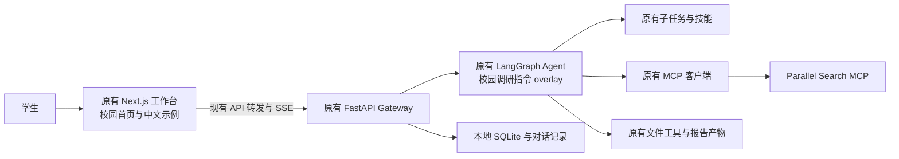

# CampusResearch · 校园选题调研助手

基于 [ByteDance DeerFlow](https://github.com/bytedance/deer-flow) 完整产品改造，面向计算机专业学生：从一个毕业设计想法出发，查资料、比较实现路线、划分功能范围，再生成带来源的开发计划。

当前基线提交：`8b68832f32a0bb724e1ca39983ae0c43284a0c40`。保留上游 MIT 许可、原始文档和完整前后端代码。没有重写 Agent 框架。

## 先运行

在本项目目录中执行：

```powershell
python campus.py configure
python campus.py start --preview
```

`configure` 仅创建缺失的本地文件，重复执行不会覆盖已有密钥、MCP 配置或模型设置。本机已经安装前后端依赖。预览启动后打开 **http://127.0.0.1:3000**，按 `Ctrl+C` 停止前后端。

本机曾遇到火绒将上游 `backend/packages/harness/deerflow/skills/skillscan/orchestrator.py` 隔离的问题；该模块包含识别反向 Shell 的扫描规则。用户处理拦截后，已从原提交恢复文件，后端启动成功。未删减扫描逻辑。若再次提示该文件缺失，应检查对应隔离记录。

本机已经完成生产构建，也可使用 `python campus.py start --preview --production` 快速预览，避免首次开发编译等待。修改前端后需重新构建：在 `frontend` 执行 `pnpm exec next build --webpack`。

预览模式只允许在缺少模型配置时启动界面，不会提供真实调研回答。缺少任一模型配置时，模型请求地址会被设为本机不可用端口，避免将占位密钥发给第三方。

要真实生成回答，在项目根目录 `.env` 中填写：

```dotenv
CAMPUS_MODEL_NAME=供应商控制台中的准确模型名称
CAMPUS_MODEL_BASE_URL=供应商提供的OpenAI兼容接口地址
CAMPUS_MODEL_API_KEY=你自己的密钥
```

模型需要支持工具调用与流式输出。密钥只填本地 `.env`，不要提交仓库或发到聊天里。填好后重启：

```powershell
python campus.py start
```

当前校园模板使用 DeepSeek：`CAMPUS_MODEL_NAME=deepseek-flash`，`CAMPUS_MODEL_BASE_URL=https://api.deepseek.com`。复用上游 `PatchedChatDeepSeek`，支持思考与多轮工具调用所需的思考历史回传，默认思考强度为 low。模型 API 按供应商规则计费，网页版会员不等于 API 额度。配置依据：[DeepSeek 思考模式与工具调用](https://api-docs.deepseek.com/guides/thinking_mode/)。

### 四项 Agent 能力

新浏览器默认选择 **Ultra + low 思考强度**，该模式会同时开启计划和子 Agent。Pro 使用计划，Flash 用于简单问答。模型支持信息已配置，原有模式菜单现在可以正常选择。已有浏览器会保留此前的选择，因此开始复杂调研前应检查模式并切到 Ultra。

| 能力 | 校园配置与实际机制 |
| --- | --- |
| 多 Agent | 主 Agent 用 `task` 分派独立核实任务；最多 3 个子任务，每个最多 12 轮、240 秒；本次验收同时运行 2 个 |
| Plan | Ultra/Pro 向运行上下文传入 `is_plan_mode`，模型用 `write_todos` 维护计划及完成状态 |
| 上下文压缩 | 自动摘要已开启：消息达到 12 条或估算上下文达到 12000 tokens 时触发，保留最近 6 条；摘要写回线程状态 |
| 工具按需加载 | `tool_search.enabled: true`；MCP 工具完整 schema 按检索结果加载，文件等基础工具仍直接可用；技能元数据也使用延迟发现 |

单轮累计 Token 上限为 350000，子任务为 100000。这是多次请求的累计输入输出用量保护，不是上下文窗口或人民币费用上限。子任务最多两次外部请求，遇限流停止重试；压缩控制上下文体积，但不能消除已经产生的调用费用。

LangGraph 执行步数上限设为 250。它包括中间件节点，不等于调用模型 250 次；原先 60/100 的配置曾使任务在文件已写入、尚未登记下载时中断。

`campus.py configure` 不覆盖已有配置。本机 `config.yaml` 已同步上述设置，新安装则从校园模板创建。

### 复现实测

启动真实服务后，在项目目录运行（会消耗模型 API 额度并访问外部 MCP）：

```powershell
.\backend\.venv\Scripts\python.exe campus/live_acceptance.py
```

脚本使用“校园失物招领系统，Python 基础、单人八周、每月预算不超过100元”作为输入，检查两个子 Agent 完成、计划完成、工具发现、真实搜索和读取、自动摘要、七节报告及接口下载。记录保存在忽略目录 `campus/live-results/`。若报告已写入但执行中断，可用 `--resume` 在同一会话中仅完成交付，避免重搜；尚未生成报告时不要用这个恢复选项。

`campus/browser_acceptance.mjs` 使用本机 Playwright 浏览器打开该会话，展开报告预览，点击真实下载控件，并比对接口与浏览器下载文件的 SHA-256。它不调用大模型，也不 mock 后端。本机需设置 `PLAYWRIGHT_BROWSERS_PATH` 为项目 `.tools/playwright`，并使用 Node.js 22+。

## 功能和使用方式

零基础教学示例：运行 `backend/.venv/Scripts/python.exe campus/lessons/lesson02_tool_call.py`，观察工具名称、参数、函数执行和工具结果消息。该脚本手写模拟模型请求，不调用模型或 MCP，不消耗 API 额度；只会在 `campus/lessons/outputs/` 创建或覆盖本课的 `lesson02-report.md`，不会修改实测报告。

第三课：运行 `backend/.venv/Scripts/python.exe campus/lessons/lesson03_messages_state.py`，观察 `messages`、`todos` 与 `artifacts` 的变化，生成本课报告与 `lesson03-state.json`；随后加 `--load` 再运行，在新进程中只读取已保存状态。模型响应、计划和登记动作均为手写模拟；JSON 存储用于教学，真实运行使用上游 checkpointer/SQLite。所有输出仍在被忽略的 `campus/lessons/outputs/` 中。

第四课：运行 `backend/.venv/Scripts/python.exe campus/lessons/lesson04_planning.py`，观察完整计划更新、未完成提醒、草稿写入成功但章节验收失败、修改后通过检查并完成登记。拆分与更新决定是手写模拟；报告检查是额外的教学规则，不是生产 `write_todos` 的自动验收能力。输出为本课目录内的 `lesson04-report.md` 和 `lesson04-state.json`，不调用模型或 MCP。

第五课：运行 `backend/.venv/Scripts/python.exe campus/lessons/lesson05_mcp_client.py`，客户端自动启动 `lesson05_mcp_server.py`，经真实 stdio MCP 完成初始化、`tools/list` 和两次 `tools/call`，保存 `outputs/lesson05-mcp.json`。无外网和模型调用，搜索与网页文本均为静态教学占位数据。本机 SDK 为 MCP 1.30.0，按其 2025-11-25 协议流程演示；不将 initialize 握手流程宣称为所有后续协议版本的要求。真实 Parallel HTTP 接入仍由 `campus/verify_mcp.py` 单独验证。

第六课：运行 `backend/.venv/Scripts/python.exe campus/lessons/lesson06_multi_agent.py`，观察两个异步教学子任务先后启动、等待重叠、分别返回并由主任务汇总；加 `--fail-b` 演示 B 失败时保留 A 的结果并说明缺口。脚本不创建真实 Agent、不调用模型或 MCP，使用静态结果与 `asyncio.sleep` 模拟耗时；分别保存 `outputs/lesson06-success.*`、`outputs/lesson06-failure.*`，不将教学耗时当作产品性能指标。

第七课：运行 `backend/.venv/Scripts/python.exe campus/lessons/lesson07_context_tools.py`，对照13条模拟消息压缩为5条、当前请求与独立计划保留、手写摘要进入 `summary_text`、MCP 工具 schema 在发现后暴露、未激活调用被拦截及新轮次作用域失效。输出为 `outputs/lesson07-context-tools.json`；无模型、MCP 或真实摘要器调用。保留尾部逻辑只适用于本课完整消息对，不代替上游消息保护；字符数不作为 Token 或成本统计。

第八课：运行 `backend/.venv/Scripts/python.exe campus/lessons/lesson08_debug_testing.py`，观察人为注入的临时限流、超时、额度耗尽、参数错误、工具错误标记、持续限流与教学预算不足；演示有限退避重试和草稿拒收。预算点数、异常与报告均为教学样例，无网络或模型调用。运行 `backend/.venv/Scripts/python.exe -m unittest discover -s campus/lessons -p test_lesson08_debug_testing.py -v` 可执行11项策略与交付检查；通过仅表示本地机械条件满足，不证明事实正确或真实浏览器下载成功。

第九课的源码阅读、逐行解释、验证命令与面试表达见 [真实前端改动讲义](campus/lessons/lesson09_report_review.md)。

第十课新增真实本地工具 `estimate_project_schedule`，代码在 `campus/tools.py`，已登记校园模板和本机配置。输入功能工时、每周投入、剩余周数与预留比例，计算工期和工时缺口；它不自动推断功能难度，不保证按期完成，也不会修改计划或文件。运行 `backend/.venv/Scripts/python.exe campus/lessons/lesson10_agent_tool.py`（或加 `--invalid-first`）查看配置解析、真实 LangGraph 工具调用与错误回传。模型回复及修正请求是预设教学数据，无模型或外部 MCP 调用。测试命令：`backend/.venv/Scripts/python.exe -m unittest discover -s backend/tests -p test_campus_project_tools.py -v`。逐行教程见 [新增 Agent 工具讲义](campus/lessons/lesson10_agent_tool.md)。本地启动器已补充根目录导入路径，其他启动方式需自行设置项目根目录为 `PYTHONPATH`；已有配置不会被 `configure` 覆盖。完整后端仍因上游扫描器缺失受阻，不能将离线通过视为在线验收。

| 入口 | 输入示例 | 预期交付 |
| --- | --- | --- |
| 选题调研 | 校园失物招领系统，Python 基础，两个月 | 类似产品、开源参考、三种技术路线、按周计划 |
| 技术路线 | 课程资料问答助手，比较 RAG 与长上下文 | 路线对比、成本和测试条件、建议选择 |
| 缩减范围 | 二手交易系统，只剩一个月 | 必做/可选/暂缓功能、四周验收计划 |
| 答辩准备 | 项目采用 LangGraph 与 MCP | 架构解释、演示流程、测试证据清单及常见追问 |
| 报告复核 | 粘贴或上传已有调研报告，补充个人基础、周期与预算 | 来源、方案适配、功能与计划、交付证据的复核清单 |

进入工作台后点击中文示例，会填入一段可修改的完整需求。保留原有对话历史、附件、任务进度、子任务卡片、文件预览与下载、技能和设置界面。复杂任务可选择原有深度模式使用子任务；简单追问不要求拆分。

第九课直接修改真实前端：在 `frontend/src/core/i18n/locales/zh-CN.ts` 与 `en-US.ts` 的 `inputBox.suggestions` 新增“报告复核 / Review report”，复用 `SuggestionList` 的列表渲染和 `textInput.setInput`，不改后端。打开新对话，点击“报告复核”，补充报告内容或上传文件，确认后自行发送。该入口只是用户可编辑的复核请求，不会自动提交、读取其他对话报告，也不提供确定性事实验证。`frontend/tests/e2e/campus.spec.ts` 使用模拟后端验证电脑/手机显示、输入填充、可编辑与不自动启动运行，不测试模型复核质量；生产模式修改后需要重新构建并重启前端。

完整调研报告的默认格式为：

1. 选题背景与目标用户
2. 类似产品及开源项目
3. 可选技术路线对比
4. 建议实现的功能
5. 开发计划（按周、交付物、验收标准）
6. 风险与尚需验证的问题
7. 参考来源（标题、链接、核实日期）

指令要求将完整报告存为 `campus-research-report.md`，交由原有产物系统预览和下载。这是模型行为约束，不是一个强制校验报告章节的程序；实际完成情况需用你的模型测试。Word/PPT 等更复杂产物仍取决于上游技能及沙箱依赖，当前默认只要求 Markdown 报告。

## MCP 已接入什么

配置模板：[campus/extensions_config.example.json](campus/extensions_config.example.json)。`configure` 将其复制到根目录的 `extensions_config.json`，DeerFlow 原有 MCP 加载器会读取它：

```json
{
  "mcpServers": {
    "parallel-search": {
      "enabled": true,
      "type": "http",
      "url": "https://search.parallel.ai/mcp",
      "headers": { "User-Agent": "deer-flow" }
    }
  }
}
```

- `web_search`：搜索公开网页。
- `web_fetch`：读取指定来源网页，帮助核对搜索摘要。
- 通过上游通用 MCP 客户端发现工具并调用，没有自建伪 MCP。
- 本机已用匿名连接实际完成初始化、工具发现、检索和原文读取，不需要 Notion、飞书、WPS、企业账号或 GitHub 登录。
- 本次匿名测试不需要搜索 API Key；远程服务的限额、收费规则和网络可达性可能变化。模型调用另由模型供应商计费。
- 多 Agent 实测曾触发服务返回的免费额度限流，匿名连接不能保证连续调研可用。发生限流时应停止重试并标注资料缺口；若需要更高限额，可自行在 Parallel 平台申请 Key，按服务提示在本地 MCP `headers` 添加 `x-api-key`，不要提交密钥。
- 搜索词与读取的 URL 会发给该外部服务，使用公开课题资料即可。

重新实测（会联网，不调用大模型）：

```powershell
.\backend\.venv\Scripts\python.exe campus/verify_mcp.py
```

结果仅保存非敏感状态信息到 `campus/local-verification.json`，不保存抓取到的网页原文。该测试验证 MCP SDK 的真实调用，不等于模型驱动的全流程已经通过。

## 架构与复用边界



本地启动器使用 Next.js 已有的 API 转发，不额外安装 Nginx；浏览器只访问 3000，后端运行在 8001。两项服务均绑定 `127.0.0.1`。上游 Docker/Nginx 部署方式仍保留。

| 部分 | 来源或本次改动 |
| --- | --- |
| Agent 循环、LangGraph 状态、子 Agent、流式输出 | DeerFlow 原有能力 |
| 历史、SQLite、文件产物、记忆、技能、MCP 客户端 | DeerFlow 原有能力 |
| 校园首页、中文欢迎语、快捷需求、名称 | 本次场景改造 |
| 七段报告、依据与推断区分、时间与能力约束 | `campus/config.example.yaml` 的 prompt overlay |
| 外部搜索配置与实测脚本 | 复用通用 MCP 接口，本次提供可复现验证 |
| 本地配置初始化、双服务启动和预览提示 | `campus.py` 与小范围前端改动 |

当前校园配置启用了文件工具及外部搜索，保留所有原有工具的源代码，但不默认开放宿主机 Shell，也不要求图像搜索、付费知识库和企业文档服务。LocalSandbox 的文件映射不是 Docker 等级的操作系统隔离；需要运行生成代码时，再按上游文档配置隔离沙箱。

## 换一台电脑安装

需要 Python 3.12+、Node.js 22+、uv、pnpm 10.26.2+。在项目根目录：

```powershell
uv sync --project backend --frozen
cd frontend
pnpm install --frozen-lockfile
cd ..
python campus.py configure
```

本机默认 Node.js 较旧，启动器会优先检查可用版本，并尝试使用 Codex 自带的新版 Node.js；其他电脑直接安装新版 Node.js 即可。本机辅助安装工具位于被忽略的 `.tools`，缓存不属于项目业务代码。

校园默认配置是本地个人开发模式：`DEER_FLOW_AUTH_DISABLED=1`。若部署给他人使用，应重新启用上游认证，并按上游部署文档配置网络和密钥；不要直接把本地预览服务开放到公网。

日志位于 `logs/campus-gateway.log` 与 `logs/campus-frontend.log`。启动前检测端口占用，不会替你停止其他应用。`config.yaml`、`extensions_config.json`、`.env` 和运行数据均忽略提交。

## 验收和面试演示

本次验证记录见 [campus/VALIDATION.md](campus/VALIDATION.md)。可以重跑：

```powershell
python -m unittest discover -s campus -p test_launcher.py -v
cd frontend
pnpm check
pnpm exec rstest run tests/unit/core/i18n
pnpm build
```

有模型密钥并解除启动阻碍后，按这个顺序实测：

1. 点击“选题调研”，提交校园失物招领需求，观察实际 MCP 工具调用与来源链接。
2. 查看三条路线是否有真实差异、参考项目是否可访问、计划是否符合两个月限制。
3. 查看并下载 Markdown 报告，确认七部分和引用完整。
4. 追问“只剩一个月，请缩减范围”，检查是否沿用对话资料并重新安排计划。
5. 刷新页面和重启服务，检查历史是否仍存在。

面试可以解释：为什么选择复用完整产品、MCP 与普通 HTTP 调用的区别、LangGraph 状态与流式事件如何到达页面、为什么来源需读取原文、如何保证报告在时间和能力范围内可执行。明确说本项目是基于 DeerFlow 的场景改造，展示自己修改的文件和测试证据；不要将上游架构和未经测量的性能指标写成自己的原创成果。
